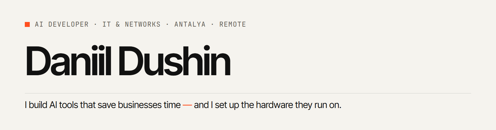

<picture>
  <source media="(prefers-color-scheme: dark)" srcset="assets/banner-dark.png">
  
</picture>

I build Python tools with LLMs and Telegram bots for small businesses, and I install and
support the hardware they run on: IP cameras, recorders, sensors and MikroTik networks.
Right now I deploy an AI computer-vision system for hotels and restaurants in Antalya.
Open to remote work, full-time or part-time.

**[Portfolio, case studies and live demos →](https://site-production-898c.up.railway.app)**

## Projects

Every project has a live demo that runs **in your browser**: the project's own Python code,
compiled to WebAssembly. No sign-up, nothing sent to a server.

| Project | What it does | Demo | Code |
|---|---|---|---|
| **E-Invoice** | PDF invoice → XRechnung e-invoice, checked against 67 EN 16931 / XRechnung rules | [▶ Run](https://site-production-898c.up.railway.app/en/projects/e-invoice/demo) | [e-invoice](https://github.com/dushinitspec-ux/e-invoice) |
| **PII Guard** | Hides personal data before a prompt reaches an LLM and puts it back in the answer (GDPR) | [▶ Run](https://site-production-898c.up.railway.app/en/projects/pii-guard/demo) | [pii-guard](https://github.com/dushinitspec-ux/pii-guard) |
| **Helpdesk Copilot** | IT answers from the company's own how-tos with sources; everything else becomes a P1–P4 ticket | [▶ Run](https://site-production-898c.up.railway.app/en/projects/helpdesk-copilot/demo) | [helpdesk-copilot](https://github.com/dushinitspec-ux/helpdesk-copilot) |
| **Network Inventory** | Asset register for office networks: new devices, risky open ports, CSV export (NIS2) | [▶ Run](https://site-production-898c.up.railway.app/en/projects/network-inventory/demo) | [network-inventory](https://github.com/dushinitspec-ux/network-inventory) |
| **Accessibility Check** | WCAG 2.2 checks for small business websites (European Accessibility Act) | [▶ Run](https://site-production-898c.up.railway.app/en/projects/accessibility-check/demo) | [accessibility-check](https://github.com/dushinitspec-ux/accessibility-check) |
| **Energy Saver** | Runs boilers and EV chargers in the cheapest 15-minute slots of the day-ahead market | [▶ Run](https://site-production-898c.up.railway.app/en/projects/energy-saver/demo) | [energy-saver](https://github.com/dushinitspec-ux/energy-saver) |
| **Allergen Labels** | The 14 EU allergens on every dish, in four languages, confirmed by a chef | [▶ Run](https://site-production-898c.up.railway.app/en/projects/allergen-labels/demo) | [allergen-labels](https://github.com/dushinitspec-ux/allergen-labels) |
| **Hotel AI Concierge** | Answers hotel guests in EN/RU/TR/DE only from the hotel's own facts | [▶ Run](https://site-production-898c.up.railway.app/en/projects/hotel-ai-concierge/demo) | [hotel-ai-concierge](https://github.com/dushinitspec-ux/hotel-ai-concierge) |
| **Fridge Alert Bot** | Telegram alert when a kitchen fridge stays too warm, without alert spam | [▶ Run](https://site-production-898c.up.railway.app/en/projects/fridge-alert-bot/demo) | [fridge-alert-bot](https://github.com/dushinitspec-ux/fridge-alert-bot) |
| **Uptime Monitor** | Tells you in Telegram the minute a camera, router or access point goes down | [▶ Run](https://site-production-898c.up.railway.app/en/projects/uptime-monitor/demo) | [uptime-monitor](https://github.com/dushinitspec-ux/uptime-monitor) |

The website itself (Next.js, four languages, the in-browser demo runtime) is in
[portfolio-daniil](https://github.com/dushinitspec-ux/portfolio-daniil).

## How I work

- **Python 3.12** · FastAPI · aiogram 3 · SQLite · pytest · ruff · Docker
- **LLMs:** Claude and OpenAI APIs, structured output, retrieval (BM25), evaluation sets, offline demo modes
- **Web:** Next.js · TypeScript · Tailwind CSS · Pyodide
- **Hardware & networks:** MikroTik RouterOS · CCTV / NVR · access control · Windows
- I build with AI coding agents (Claude Code, OpenAI Codex) and check everything myself:
  every project has automated tests (more than 1,300 in total), CI on every push and a
  `BUGFIX.md` with the real bugs I found and fixed.

## Contact

[dushin.itspec@gmail.com](mailto:dushin.itspec@gmail.com) ·
[Telegram](https://t.me/daniil_dushin) ·
[LinkedIn](https://www.linkedin.com/in/daniil-dushin) ·
[Website](https://site-production-898c.up.railway.app) ·
[CV (PDF)](https://site-production-898c.up.railway.app/cv/daniil-dushin-cv-ai-developer.pdf)
